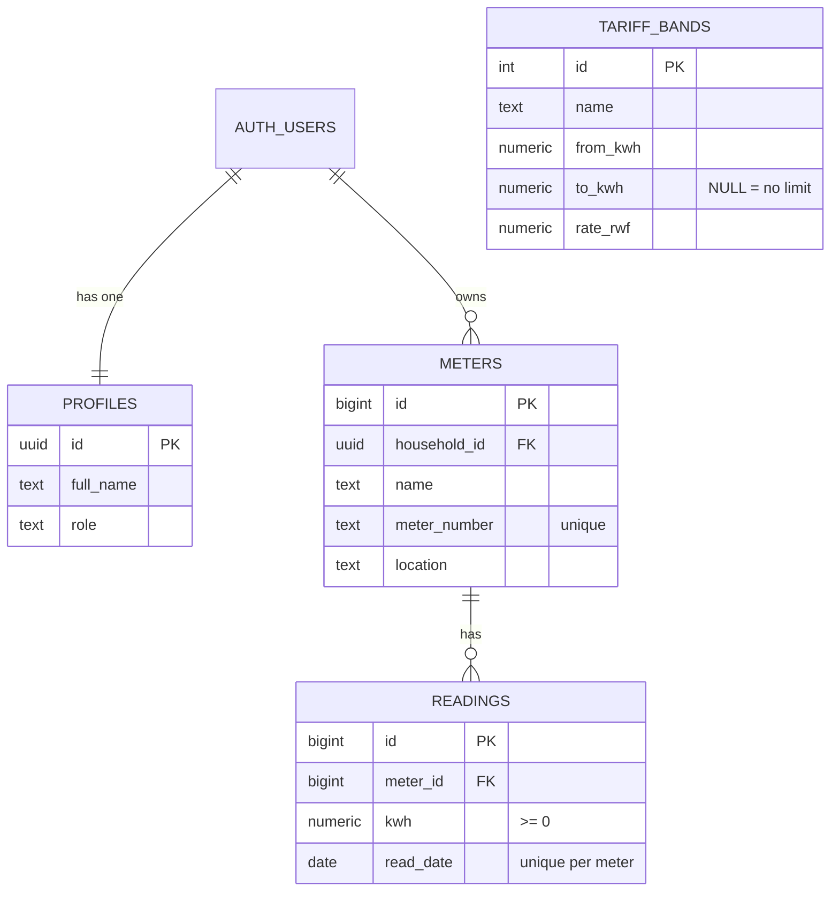

# Data model: what the database stores

The app stores four things. Each is a table in Supabase.

| Table | What it is | Main fields | Who owns it |
|---|---|---|---|
| `profiles` | One row per user, holds the role | `id`, `full_name`, `role` | the user |
| `meters` | An electricity meter | `id`, `household_id`, `name`, `meter_number`, `location` | `household_id` |
| `readings` | The number on a meter on one date | `id`, `meter_id`, `kwh`, `read_date` | through its meter |
| `tariff_bands` | Price per kWh for each usage band | `id`, `name`, `from_kwh`, `to_kwh`, `rate_rwf` | shared, read-only |

## How the tables connect
- One user has **many** meters (`meters.household_id` points to the user).
- One meter has **many** readings (`readings.meter_id` points to the meter). Deleting a meter deletes its readings.
- `tariff_bands` is a price list used when working out a bill.

A drawing is in `data-model.svg`. GitHub also draws this one:

## Rules built into the database
- Every table has a primary key. Foreign keys connect meters to users and readings to meters.
- Required fields are NOT NULL. `kwh` cannot be negative.
- **One reading per meter per day.**
- The meter number is unique.
- Length limits: name 100, meter number 50, location 200.
- Row Level Security: a user only sees their own meters and readings.

## What is not stored
**Usage and bills are calculated, not stored.** Usage is this reading minus the previous reading. The bill is worked out from the usage and the tariff bands. Storing only the readings means the numbers can never disagree with each other.

## Sample data
`seed.sql` adds 2 meters and 8 readings (10 rows) to the first user. Readings are on the last day of each month so the chart shows monthly bars.
